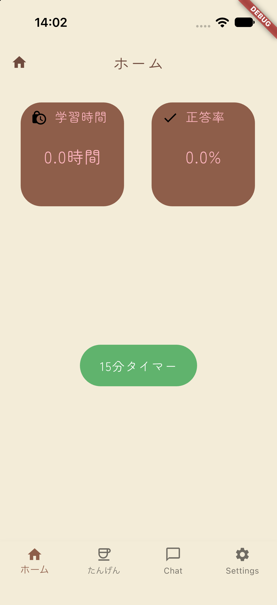
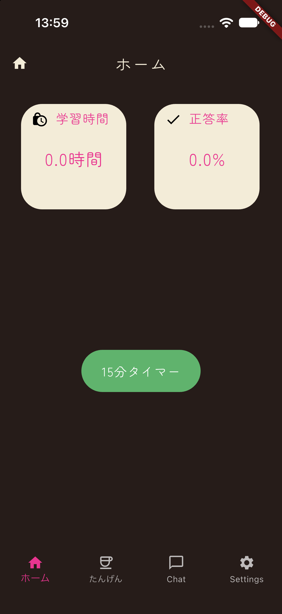
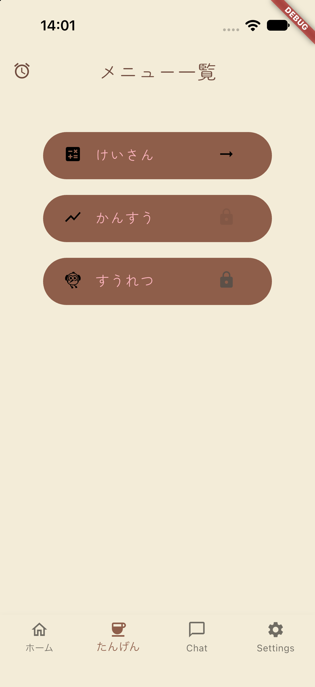
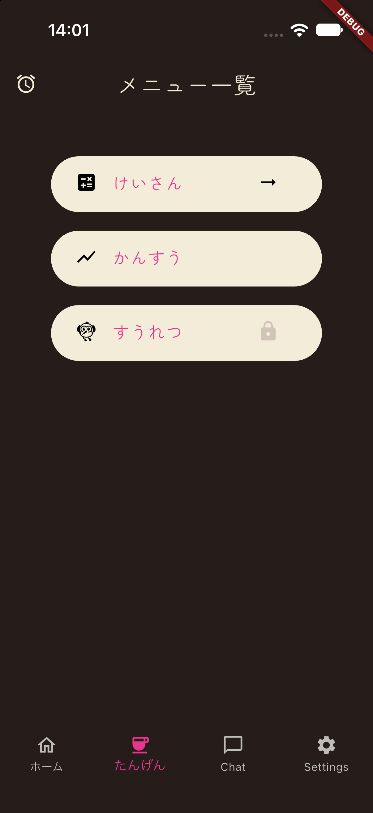
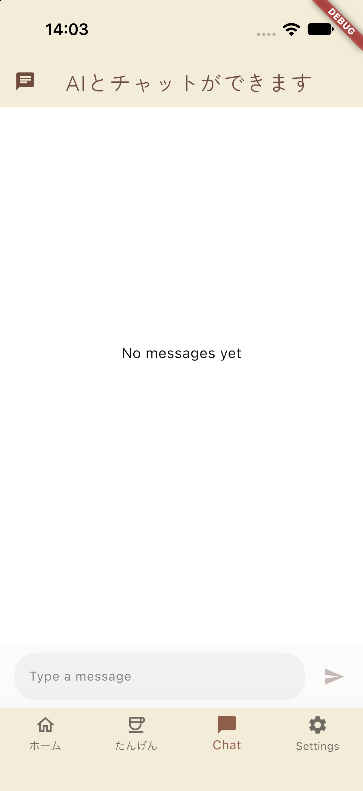
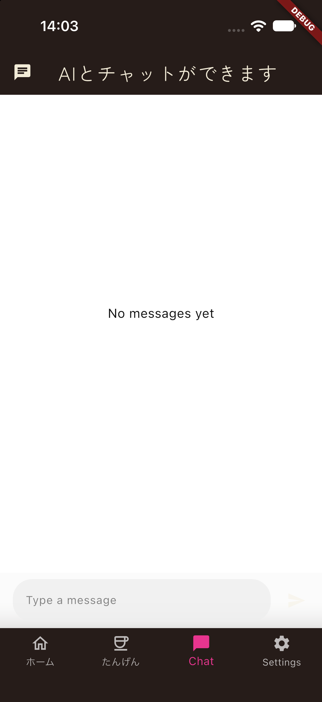
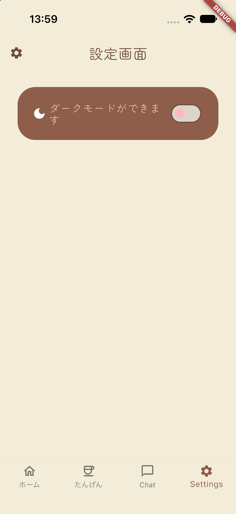
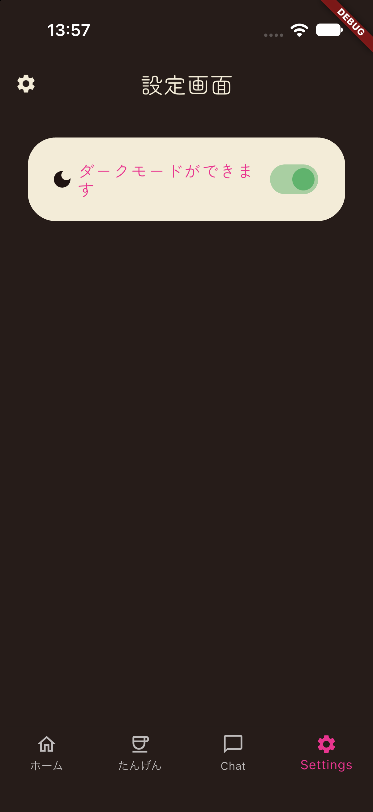

# math_café☕️
## アプリ概要
> **「数学がとても苦手な高校生の従姉妹だけのアプリ」**

## 作ろうとした背景
従姉妹とチャットアプリで話す機会があり、<i>「どんな教科が苦手？」</i>と送ったら<i>「数学」</i>と返ってきたやりとりがありました。<br>
さらに、<i>「どんな単元が苦手なの？」</i>と質問したところ、<i>「全部笑」</i>と彼女の返答が来たため、ポートフォリオ作成のチャンス/彼女の苦手克服になると思い、作ろうと決心しました。

## デザインについて
* 市販の勉強/教科別学習アプリにある`青色系・緑色`系のデザインだと堅いデザインになってしまい、彼女の苦手意識が取れないと思ったので、女子高校生が好きなカフェでよく使われている`ピンク系・ブラウン系・抹茶系の色`を使い、苦手克服に努めました。

___

## 機能一覧
| 機能 | 内容 | 備考 |
| --- | --- | --- |
| タイマー | 従姉妹が集中しやすいよう15分のタイマーを作りました。 | |
| クイズ | ランダムで10問の4択式形式にしたことで、²,√, ±などの入力が難しい数学記号の入力を省略することで、ストレス軽減に努めました。 |  |
| チャット機能 | Flutter(Google製)と相性がいいGemini API(無料枠)を使い、学校での質問以外でも365日24時間わからないことがあったら聞けるようにしました。 |  |
| ライトモード/ダークモード | 夜中や暗闇の中でも学習しやすいよう、目に優しいダークモードを入れました。 ||

___

## 使用スタック/選んだ理由
| 技術/パッケージ | 用途 | 選定理由 |
| :--- | :--- | :--- |
| Flutter(Dart) | クロスプラットフォーム対応 | 従姉妹はAndroidを使っているが、将来的にはiOS対応するようにするため。 |
| Isar Database | ローカルデータベース | share_preferenceのような生のMap型の保存だと、タイポミスをしたときに実行時にエラーに気づかずアプリがクラッシュしてしまうのを防ぐため(型安全)。クイズ履歴(正答率)、学習時間の保存に使用。 |
| google_fonts | フォント変更 | 一般的なカフェで使われていそうなオシャレなフォントを使用。 |
| flutter_launcher_icons | ホームアイコン | AIで生成したカフェ風のアイコンをホームアイコンに設定。 |
| flutter_math_fork | 数学記号 | 数学記号(²や√など)をより見やすくしやすいするため。 |
| shared_preferences | ダークモード切り替え | テーマ設定などの軽量なデータ保存に向いているため。 |
| flutter_chat_ui | AIとのチャット(メッセージ方式)機能のUI | 1からチャット画面を作ると膨大な時間がかかるため、既存のチャットパッケージを使い、チャット画面を作った。 |
| JSON | 問題テンプレ | 問題のテンプレを最初から用意することで、他の問題を0から作るのを防ぐため使用した。 |
| cloud_firebase | Gemini APIとのチャット履歴保存 | 従姉妹がどんな問題で躓いてAIに相談したのか、開発側で把握/分析し、今後の項目追加や学習体験の改善に活かすため。 |


↓出題テンプレの例です。
```JSON
[
  {
   
    "id": 9,
    "category": "二次不等式",
    "question": "x^2 - 4x + 3 < 0の不等式を解いてください。",
    "options": [
      "1 < x < 3",
      "x < 1, 3 < x",
      "解なし",
      "(x - 3)(x - 1)"
    ],
    "answerIndex" : 0,
    "level": "applied",
    "explanation": "1. 左側を因数分解する x^2 - 6x + 8 < 0→x^2 - 6x + 8 = (x - 4)(x - 2) \n2. x = の形にする(x = 4, 2) \n3. 不等号の向きに注意する(「<」 はxが数字に囲まれる、「>」は数字がxに囲まれる) \n4. 不等号の向きに注意して答えを出す(example: 2 < x < 4)"
  },
]

```

## フォルダ/ファイル構成
```text
.
└── lib /
    ├── components/ - ウィジェット内の部品
    │   ├── chat_widgets.dart - Chat_UIパッケージを入れる場所。
    │   ├── explanation_widget.dart - 問題文の下の解説(ヒント)のウィジェットを保存する場所。
    │   ├── home_widget.dart - ホーム画面で学習時間・正答率を表示させるウィジェットの保管先
    │   ├── option_card.dart - 4択の選択肢ウィジェットの保管先。
    │   ├── settings_container.dart - 設定画面に入れる箱の保存場所。(今回はモードを変えるウィジェットだけだが、今後増やすかもしれないので、複製しやすいように分けた。)
    │   └── unit_container.dart - Unit画面のウィジェット。
    ├── enum/ 
    │   └── difficulty.dart - JSONに入れる難易度を列挙
    ├── models/
    │   ├── question.dart - 問題を用意するための変数を保存する場所
    │   └── quiz_record.dart - クイズの結果を計算し、Home画面に表示させる
    ├── screens/ - 各画面を管理するフォルダ
    │   ├── quiz_screen/
    │   │   ├── quiz_result.dart - 問題を解いた結果/正答率を表示し、home画面の上部にあるコンテナの中にそれを表示する。
    │   │   ├── quiz_result.g.dart - Isarを使うためにコマンドを打って自動生成されたDartファイル
    │   │   ├── quiz_result_screen.dart - 問題を解いた後の結果表示
    │   │   └── starts_screen.dart - スタート画面。ボタンを押すと、問題を解けるようになる。
    │   ├── chat_screen.dart - チャット画面 
    │   ├── home_screen.dart - ホーム画面
    │   ├── settings_screen.dart - 設定画面
    │   ├── timer.dart - タイマー開始から終了まで
    │   ├── timer_screen.dart - 15分のタイマー画面
    │   └── unit_screen.dart - 単元画面
    ├── services/
    │   ├── gemini_service.dart - Gemini APIを保存する場所
    │   ├── isar_service.dart - 学習時間・問題の正答率を保存する場所。
    │   └── quiz_service.dart - Isarデータベースのデータ定義ファイル。
    ├── theme/ - テーマ(モード変更/カラー・フォント)を保存するフォルダ
    │   ├── app_themedata.dart - ダークモード/ライトモードの色を保存
    │   └── app_textdata.dart - 画面で使うフォント(Google Fonts Package)を保存
    ├── firebase_options.dart - FlutterFire CLIの flutterfire configure コマンドを実行し、lib/firebase_options.dart として自動作成されたファイル。
    └── main.dart - 実行部分

```

## アプリのスクショ
<br>












## インストール手順

### バージョン説明
あらかじめ以下のバージョンをインストールしてください。

- **Flutter SDK** : v3.47.7以上
- **Dart**: v3.13.5以上(Flutterをインストールすると自動でインストールされます)
- **IDE**: VSCode, Google Antigravity(推奨), Android Studio
    - Flutter/Dart拡張機能をインストールしてください。
    - 最新バージョンを使っております。
    * 2026.10.18現在
```bash
#①git cloneします。
git clone https://github.com/htyFlutter/Portfolio.git

#②Portfolioフォルダに移動します。
cd Portfolio

#③パッケージをインストールします。
flutter pub get

#④build_runnerコマンドを実行し、コードを自動生成します。
dart run build_runner build

#⑤テストします。
flutter test

#Gemini APIキーを取得し、アプリを起動します(チャット機能を使う場合のみ以下のコマンドを実行してください。)
flutter run --dart-define=GEMINI_API_KEY=Your_Key

```


## 使用したAI
* Claude Code
* GoogleのAIモード(AIによる概要)
* Google Antigravity
* Gemini
* Gemini NotebookLM

### 使用目的
Gemini NotebookLMにアプリの参考になりそうなウィジェット、Dart構文ののソースを入れ、わからないところがあったらNoteboolLMと連携したGemimi/GoogleのAIなどに聞きました。


## NotebookLMに入れたソース（一部）
- [Flutter documentation Widget Catalog](https://docs.flutter.dev/ui/widgets)
- [Dart API Docs](https://api.dart.dev/)
- [Flutter Official Youtube Channel](http://www.youtube.com/@flutterdev)
- [Isar Tutorials](https://isar.dev/ja/tutorials/quickstart.html)

## 反省点/今後の予定
 - 彼女にヒアリングしてみて、もし反応がかったら他の単元を増やしたい。
 - 周りの友人などにもテストしてもらい、こちらでも反応が良かったらiOS対応を目指したい。 
 - 適当の値でUIの大きさ/余白を決めてしまったので、別のアプリを作るときや新しい画面を作るときは、「8の倍数ルール」を採用し、UIを作っていきたい。
 - 設定画面がまだ「ライトモード/ダークモード切り替え」しかないので、通知機能などの機能を増やしていきたい。
 - ◎AIに頼ってしまったところが何箇所もあるので、なるべく自分でしっかり設計を立ててコードを書いていきたい。
